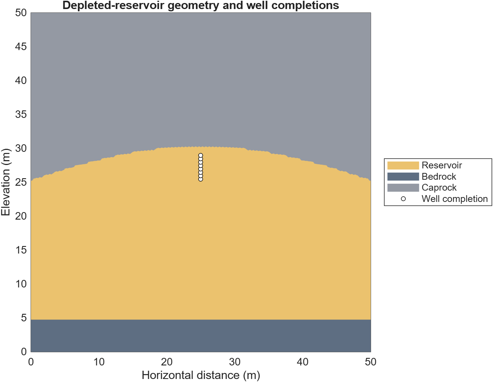
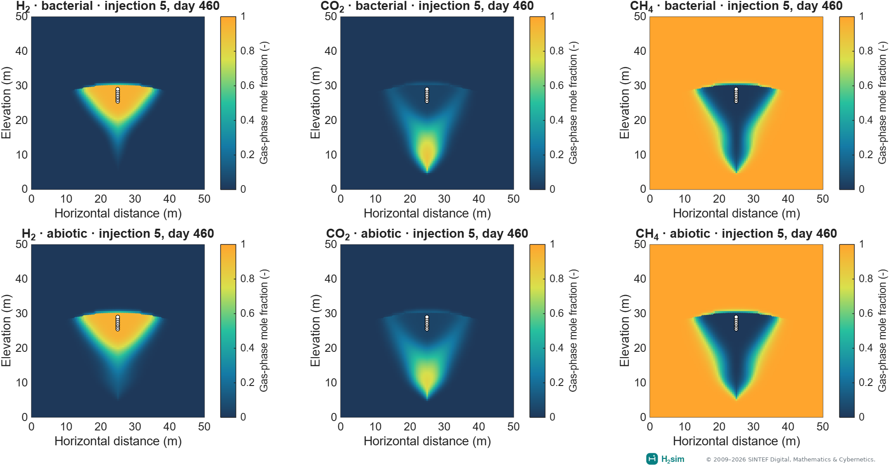
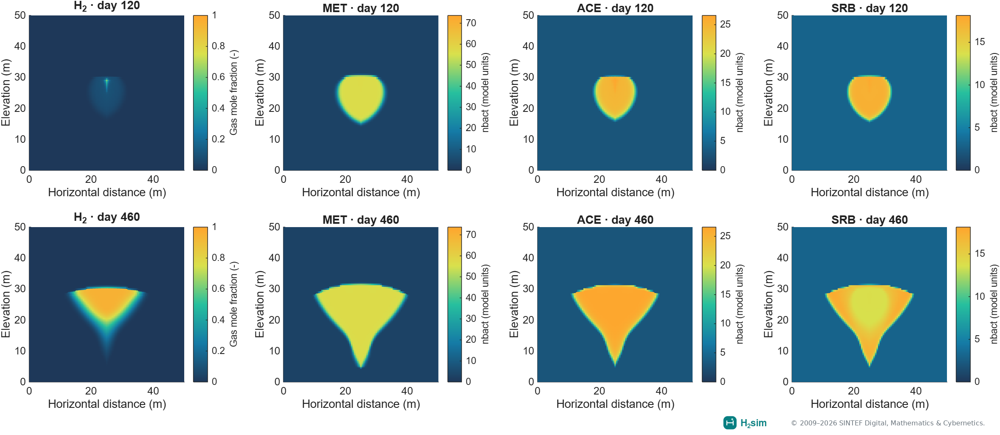
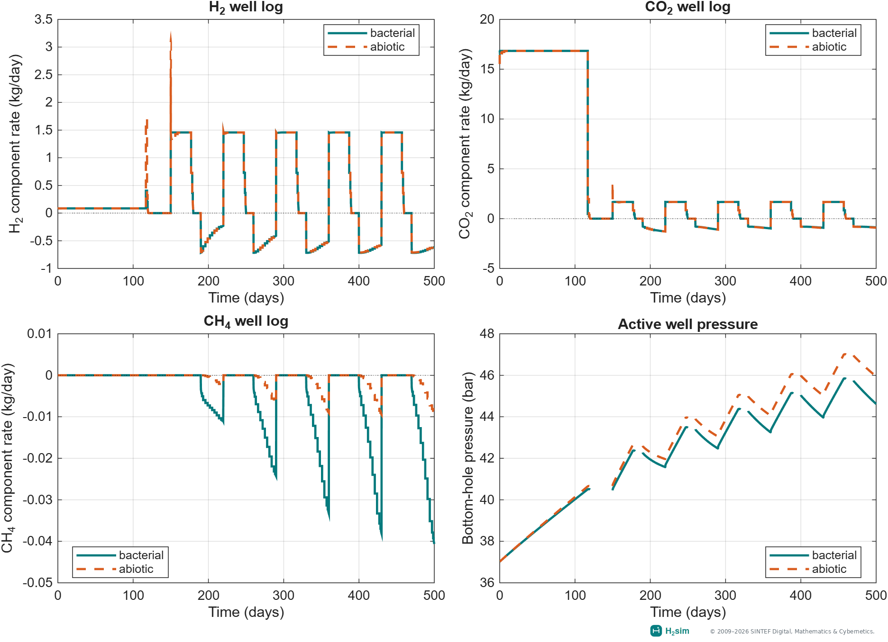
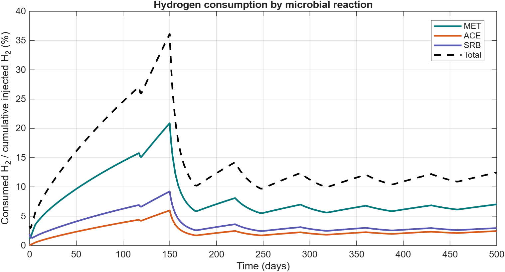

Hydrogen storage in depleted gas reservoirs
===========================================

Compositional flow with bacterial effects · ``h2-biochem``

The biochemistry module extends MRST compositional flow with microbial
populations, reaction pathways, and aqueous tracer transport. This model
family supports studying injected hydrogen mixed with residual reservoir
gases. The selected 2D example uses the existing three-reaction reservoir case
with residual methane and five storage cycles. A one-dimensional notebook
remains available as an introduction.

See :doc:`biochemistry-model` for the population balances, Monod rates
and reaction-source normalization, and :doc:`compositional-model`
for component and aqueous-tracer transport.

.. raw:: html

   <video controls loop muted playsinline preload="metadata" style="width:100%;max-width:1280px" poster="_static/examples/biochemistry_storage.png" aria-label="Hydrogen gas fraction and three microbial populations through five storage cycles">
     <source src="_static/examples/biochemistry_storage.mp4" type="video/mp4">
     <a href="_static/examples/biochemistry_storage.gif">View the animated GIF</a>.
   </video>

The animation follows the presentation used for :doc:`hydrogen-anticline`
and :doc:`store`. Four maps show gas-phase H₂ mole fraction and the MET, ACE
and SRB population variables. H₂ is hidden where gas saturation is below
``0.001``; it is a gas composition map, not a gas saturation map. Hydrogen
uses fixed limits of zero to one. Each population has its own fixed scale,
calculated over the entire saved history and shared with the static figures.
``nbact`` remains in model units, not calibrated cell counts per volume.

The histories show cumulative reaction consumption as a percentage of
cumulative injected hydrogen and signed H₂ component well rates. The percentage
can decline while more hydrogen is injected. Initial and accepted states are
selected by physical time, preserving every operating-stage endpoint without
interpolation. Labelled simulation times are uneven; playback is not real time.
The maps have no vertical exaggeration.

Download the :download:`MP4 <_static/examples/biochemistry_storage.mp4>`,
:download:`GIF <_static/examples/biochemistry_storage.gif>` or
:download:`provenance record <_static/examples/biochemistry_gallery_provenance.json>`.
The visuals redraw the existing saved five-cycle bacterial/abiotic results;
this presentation update does not change or rerun the physical models.

What the models include
-----------------------

* Soreide–Whitson gas–liquid partitioning.
* Methanogenesis and acetogenesis in the selected introductory notebook.
* Sulfate reduction in the corresponding multi-reaction setups.
* Optional molecular diffusion, dispersion, bacterial diffusion, chemotaxis,
  carbonate feedback, and bioclogging where supported by the setup.

The component mixture depends on the example. The multi-reaction setups
include water, hydrogen, carbon dioxide, methane, hydrogen sulfide, and acetate.

Five-cycle 2D example
---------------------

.. code-block:: matlab

   startupH2sim
   results = exampleCompositionalBacterial2DThreeReactions( ...
       'numCycles', 5, 'scenarios', {'bacterial','abiotic'}, ...
       'molecularDiffusion', false, 'molecularDispersion', false);

This uses the original geometry, layered rock, 0.5 m grid spacing, residual
methane, and default MET/ACE/SRB kinetic parameters. The selected comparison
disables additional transport and clogging effects. It uses MRST-owned
kinetics and requires neither PHREEQC nor Parallel Computing Toolbox.
Accepted states, wells, reports, and full setups are saved for replotting.
For this larger case, the optional AMGCL solver retains the compositional,
bacterial, and aqueous-tracer cell unknowns together. Its native thread count
is configurable through ``setupOptimizedLinearSolver``. See :doc:`installation`.

Geological structure
--------------------

   Rock regions and completion cells from the 10,116-cell grid used by the
   saved comparison. The geometry is shared by the bacterial and abiotic runs.

Bacterial and abiotic gas composition
-------------------------------------

   Composition at the end of fifth-cycle injection (day 460). Every panel uses
   limits from zero to one and masks cells with gas saturation below 0.001.

Hydrogen plume and microbial populations
----------------------------------------

   H₂ gas fraction and ``nbact`` for MET, ACE, and SRB after build-up
   (top) and at the end of fifth-cycle injection (bottom). Each column uses
   the animation's fixed color limits, calculated over the entire saved
   history. H₂ is masked where gas saturation is below 0.001. ``nbact`` is the model's population variable; the plotted
   values are not a calibrated cell count per volume.

Operating response
------------------

.. button-ref:: notebooks/bacterial_storage_2d
   :color: primary

   Open the 2D bacterial storage notebook →

   H₂, CO₂, and CH₄ component mass rates and bottom-hole pressure for the
   bacterial and abiotic runs. Positive component rates denote injection;
   negative rates denote production. These logs use the summed well
   component fluxes rather than local cell compositions. Closed-well rates
   are zero. Bottom-hole pressure is shown throughout the operating cycle.
   Rates are shown over their actual completed schedule intervals.

:download:`bacterial well data <_static/examples/bacterial_well_logs.csv>` or
:download:`abiotic well data <_static/examples/abiotic_well_logs.csv>`.

Hydrogen consumption by three microbial reactions
-------------------------------------------------

The saved cumulative reaction diagnostics separate methanogenesis (MET),
acetogenesis (ACE), and sulfate reduction (SRB). For each reaction we plot
consumed hydrogen as a percentage of cumulative hydrogen injected up to
that time:

.. math::

   L_r(t)=100\,\frac{\sum_c N^{\mathrm{consumed}}_{\mathrm{H_2},c,r}(t)}
   {N^{\mathrm{injected}}_{\mathrm{H_2}}(t)}.

The index :math:`c` denotes a grid cell and :math:`r` a reaction. The
numerator comes from the converged reaction source terms; the denominator
integrates positive H₂ well mass rates and converts them to moles. The total
curve sums the three contributions. The percentage can fall during injection
because its denominator increases, even though cumulative consumed moles
never decrease. Dissolution and unrecovered gas are not counted as microbial
consumption.

   Reaction-specific hydrogen consumption and its total over time.

:download:`consumption data <_static/examples/compositional_2d_h2_consumption.csv>`.

Reproduce the presentation
--------------------------

After running the comparison above, redraw the same result structures:

.. code-block:: matlab

   output = fullfile('build', 'biochemistry-gallery');
   bacterial = results(strcmp({results.name}, 'bacterial'));
   animateCompositionalBacterial2DThreeReactions(bacterial, output, ...
       'frameRate', 6, 'maxFrames', 100);
   plotCompositionalBacterial2DThreeReactions(results, 'outputDirectory', output);

Set ``'writeVideo', false`` if MPEG-4 VideoWriter is unavailable; GIF and PNG
export remain available. Rendering reads saved states without running flow.
The :download:`Model presentation guide <model-presentation.md>` records the
shared conventions for future Models pages.

Introductory notebook
---------------------

``simple1DBacterialExampleMetacet`` compares methanogenesis and acetogenesis
in a one-dimensional closed system. Both wells are closed; the three cases
use dynamic rock properties, fixed rock properties, and no microbial reactions.
The script retains its 400-step schedule and leaves its models and states in
the MATLAB workspace for inspection.

The downloadable notebooks are generated from the MATLAB source without
executing the full comparison. Run the code locally to create the plots;
the final pressure viewer uses MATLAB's interactive desktop. The source
explains the inherited clogging coefficients and the effective EOS salt
molality, which is zero in this example.

.. button-ref:: nblinks/simple1DBacterialExampleMetacet
   :color: secondary

   Open the introductory notebook →

Equation ownership
------------------

With ``phreeqcTimestepCoupling=false``, microbial source terms are owned by
MRST. The optional PHREEQC workflows change how chemistry is closed and,
for the compositional backend, which solver owns microbial kinetics.
See :doc:`phreeqc` before switching backends.

Inspect ``state.nbact`` for modeled microbial populations and the appropriate
component/tracer fields for transport. Consumption means hydrogen removed by
microbial reactions; it is distinct from unrecovered gas during withdrawal.
