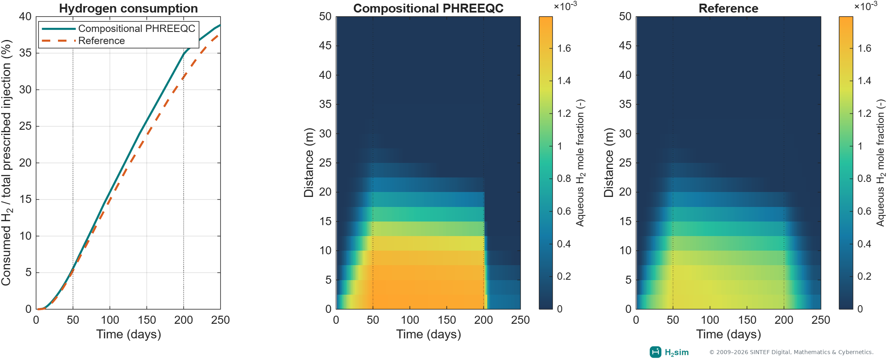

Selected examples and notebooks
===============================

Run the MATLAB commands locally and inspect their saved results in the
notebooks. Start with :doc:`model-selection` and the small commands in
:doc:`quickstart` before attempting full gallery runs.

Each entry below identifies the run command, expected output, assumptions and
MATLAB source. Run commands from the repository root after ``startupH2sim``;
use ``startupH2sim('phreeqc', true)`` for every chemistry entry. The notebook
pages show saved figures; downloading one does not install a MATLAB kernel.

Choose how to run an example
----------------------------

* **Setup check:** use ``runPhreeqcValidation('totalDays', 2,
  'plotResults', false)`` or the four-cell mineral notebook to check dependencies.
  These short runs do not reproduce full-duration figures.
* **Tutorial run:** follow a notebook's stated grid, schedule, and physical
  switches. Storage examples can be substantially larger than setup checks.
* **Exact reproduction:** use the configuration and source dataset identified
  for the displayed result. A default example with a different cycle count,
  grid, or kinetic model does not reproduce that figure.
* **Saved-result exploration:** redraw the exported multirate histories or
  inspect the three-cycle animation. Their provenance records identify the
  saved inputs; the documentation build does not rerun MATLAB simulations.

Open ``h2-biochem/examples/Contents.m`` in this checkout for the example
catalogue. Initialize H2sim with ``startupH2sim`` before running examples.

.. _example-runtime-guide:

Run sizes and recorded timings
------------------------------

These are execution-time observations, not performance guarantees. The two
recorded times below come from the linked figure provenance, on Windows
MATLAB R2026a Update 5. They describe the recorded simulation calls, excluding
animation rendering; packed runs can reuse saved output. Processor details
and a controlled cold-cache timing are not recorded. Measure your own run
with ``tic; result = ...; toc`` and record the grid, switches and cache use.

.. list-table:: What to run first
   :header-rows: 1
   :widths: 24 43 33

   * - Example
     - Run size
     - Wall-clock timing
   * - Aquifer
     - First run: 10 m target spacing, one cycle. Gallery: 2 m, five cycles.
     - Gallery recorded about 3.6 min
   * - Anticline
     - Small check: 9 × 9 horizontal cells, one cycle. Gallery: 25 × 25, ten cycles.
     - Gallery recorded about 4.4 min
   * - Gas mixing
     - Small check: 8 × 8 cells, 30 simulated days. Gallery: 40 × 40.
     - No published timing
   * - Biochemistry
     - First run: coarse grid, two steps per scenario. Gallery: 10,116 cells, five cycles.
     - No published timing; use the prefix before the full 2D comparison
   * - PHREEQC
     - Setup check: four cells, two steps. Full 1D validation: 20 cells, 125 steps.
     - No published timing; cell chemistry and reaction substeps add work
   * - Thermodynamics
     - A pressure/temperature property grid, without reservoir timestepping
     - No published timing

Timing sources: :download:`aquifer provenance <_static/examples/aquifer_gallery_provenance.json>`
and :download:`anticline provenance <_static/examples/hydrogen_anticline_provenance.json>`.
Short setup runs are not numerical regression tests; use :doc:`verification`
for the local test commands and their coverage.

Small hydrogen-mixing animation
--------------------------------

**Run:** ``result = exampleHydrogenMixing2D('gridSize', [8, 8],
'durationDays', 30, 'outputCount', 12);`` for a small check.
**Output:** initial/accepted states and conservation diagnostics; call
``animateHydrogenMixing2D(result, fullfile('build', 'mixing'))`` separately.
**Scope:** sealed hydrogen–methane gas section, gravity and diffusion, without
water or reactions. The linked guide gives the full gallery configuration.
**Source:** `exampleHydrogenMixing2D.m
<https://github.com/sintefmath/h2-sim/blob/master/h2-biochem/examples/mixing/exampleHydrogenMixing2D.m>`_.

For the anticline, use ``small = exampleHydrogenAnticline('horizontalCells',
[9, 9], 'buildupDays', 90, 'shutInDays', 20, 'numCycles', 1);``.
It returns states, well outputs and hydrogen inventory for layered black-oil
storage without reactions. The guide gives the ten-cycle animation command.
**Source:** `exampleHydrogenAnticline.m
<https://github.com/sintefmath/h2-sim/blob/master/h2-store/examples/anticline/exampleHydrogenAnticline.m>`_.

.. toctree::
   :hidden:

   hydrogen-mixing

.. grid:: 1

   .. grid-item-card:: Hydrogen–methane mixing in a sealed section
      :link: hydrogen-mixing
      :link-type: doc

      A small adaptation of a published hydrogen benchmark. Watch gravity
      and diffusion redistribute two gases; no PHREEQC is required.

.. grid:: 1

   .. grid-item-card:: Cyclic storage beneath an anticline
      :link: hydrogen-anticline
      :link-type: doc

      A four-layer Gaussian structure, cushion injection, shut-in and ten
      storage cycles. Watch the plume, well operation and hydrogen inventory.

Storage in saline aquifers
--------------------------

**Run:** the :ref:`quickstart-aquifer` command for a first simulation. For the
website's five-cycle configuration:

.. code-block:: matlab

   result = exampleBlackOilAquifer2D('numCycles', 5, 'plotResults', false);
   plotBlackOilAquifer2D(result);

**Output:** accepted states, well histories, packed output and a saved result;
plots show gas saturation, dissolution and well response.
**Scope:** hydrogen–brine black-oil flow with gravity, capillarity and
dissolution using bundled tables; no PHREEQC or new NIST downloads.
**Source:** `exampleBlackOilAquifer2D.m
<https://github.com/sintefmath/h2-sim/blob/master/h2-store/examples/exampleBlackOilAquifer2D.m>`_.

.. grid:: 1

   .. grid-item-card:: 2D aquifer storage cycle
      :link: notebooks/blackoil_storage
      :link-type: doc

      Hydrogen build-up, structural trapping, injection, and withdrawal in
      the existing aquifer model. Gravity, capillarity, and dissolved hydrogen.

.. _example-biochemistry:

Storage in depleted gas reservoirs
----------------------------------

**Run:** use :ref:`quickstart-biochemistry` for the two-step setup check.
For the full gallery configuration:

.. code-block:: matlab

   results = exampleCompositionalBacterial2DThreeReactions( ...
       'numCycles', 5, 'scenarios', {'bacterial', 'abiotic'}, ...
       'molecularDiffusion', false, 'molecularDispersion', false, ...
       'plotResults', false);
   plotCompositionalBacterial2DThreeReactions(results);

**Output:** two completed scenario structures and plots of hydrogen
consumption, microbial populations, composition and well component rates.
**Scope:** residual methane and three microbial pathways; diffusion and
dispersion are disabled for this configuration. No PHREEQC is used.
**Source:** `exampleCompositionalBacterial2DThreeReactions.m
<https://github.com/sintefmath/h2-sim/blob/master/h2-biochem/examples/2D_experiments/exampleCompositionalBacterial2DThreeReactions.m>`_.

.. grid:: 1

   .. grid-item-card:: Five-cycle 2D storage with three reactions
      :link: notebooks/bacterial_storage_2d
      :link-type: doc

      The existing 2D case with residual methane, MET, ACE, and SRB.
      Compare bacterial and abiotic injection and withdrawal on the original grid.

.. _example-thermodynamics:

Thermodynamics
--------------

.. code-block:: matlab

   study = exampleH2BrineSolubilityStudy('plotResults', false);
   plotH2BrineSolubilityStudy(study);

**Output:** property-study results and pressure, temperature and salinity
comparison plots, without reservoir timestepping.
**Scope:** distinct phase-behavior models and bundled ePC-SAFT reference data;
this command requires neither PHREEQC nor a live NIST download. New table
fetching is a separate workflow in :doc:`thermodynamics`.
**Source:** `exampleH2BrineSolubilityStudy.m
<https://github.com/sintefmath/h2-sim/blob/master/h2-biochem/examples/thermo/exampleH2BrineSolubilityStudy.m>`_.

.. grid:: 1

   .. grid-item-card:: Phase partitioning and salting-out
      :link: notebooks/thermodynamics
      :link-type: doc

      Compare RK, SW, PR, and Henry–Setschenow calculations with supplied
      ePC-SAFT reference tables. Inspect the route to black-oil PVT tabulation.

PHREEQC validation
------------------

.. code-block:: matlab

   startupH2sim('phreeqc', true)
   result = runPhreeqcValidation( ...
       'gridCells', 20, 'totalDays', 250, 'rate', 'highrate');
   plotCompositionalPhreeqcValidation(result);

**Output:** H2sim states and diagnostics across injection, storage and
production, including hydrogen consumption and aqueous chemistry.
**Scope:** 20 cells, 250 days, high-rate microbial kinetics. No external
reference checkout is needed for this command. The plotted external reference
is supplied data; reproducing it requires an explicit ``referenceRoot`` and
its separate platform requirements. For a first-step setup check, use
``'totalDays', 2, 'plotResults', false`` instead.
**Source:** `runPhreeqcValidation.m
<https://github.com/sintefmath/h2-sim/blob/master/h2-biochem/examples/1D_validation/runPhreeqcValidation.m>`_
and `exampleCompositionalPhreeqcValidation.m
<https://github.com/sintefmath/h2-sim/blob/master/h2-biochem/examples/1D_validation/exampleCompositionalPhreeqcValidation.m>`_.

.. grid:: 1

   .. grid-item-card:: Compositional PHREEQC full-cycle validation
      :link: notebooks/phreeqc_validation
      :link-type: doc

      A 20-cell, 250-day injection–storage–production comparison with a separate
      reference implementation. Compare H₂ consumption, dissolved hydrogen,
      pH, DIC, and the three metabolic pathways.

   Complete-cycle PHREEQC validation. The source of the reference and the differences
   in chemistry splitting are described in the notebook.

Three-cycle 2D PHREEQC coupling
-------------------------------

**Run:** ``exampleCompositionalBacterial2DPhreeqcMinerals`` after chemistry
startup to run the public layered setup. See :doc:`phreeqc_2d` before running.
**Output:** layered compositional/chemistry simulation output. The web gallery
uses saved continuation segments and provides consumption histories.
**Scope:** the default entry point does not reproduce the displayed three-cycle
comparison. Exact reproduction requires the continuation configurations and
saved inputs identified in the guide; no small-run timing is recorded.
**Source:** `exampleCompositionalBacterial2DPhreeqcMinerals.m
<https://github.com/sintefmath/h2-sim/blob/master/h2-biochem/examples/experimentals/exampleCompositionalBacterial2DPhreeqcMinerals.m>`_.

.. grid:: 1

   .. grid-item-card:: Hydrogen and microbial evolution in a layered reservoir
      :link: phreeqc_2d
      :link-type: doc

      Completed three-cycle results, metabolic consumption, gas composition,
      pH, and a time-slider animation comparing mobile and cell-local populations.

Short chemistry walkthroughs
----------------------------

**Mineral setup check:** follow :ref:`quickstart-chemistry` to run four cells
and two timesteps and redraw the four cases. Expect a microbial baseline plus
three mineral configurations; backend differences prevent attributing every
change to minerals alone.
**Source:** `exampleCompositionalBacterial1DPhreeqcMinerals.m
<https://github.com/sintefmath/h2-sim/blob/master/h2-biochem/examples/experimentals/exampleCompositionalBacterial1DPhreeqcMinerals.m>`_.

**Multirate setup check:** after chemistry startup, run
``summary = exampleSequentialBiochemistryPhreeqc1D('maximumFlowSteps', 2);``.
Expect states and consumption diagnostics for a short prefix with local
reaction substeps. This does not reproduce the notebook's saved 250-day
comparison. The notebook describes the full configuration, downloadable
histories, audit limitations and redraw workflow. MRST owns microbial kinetics
here; PHREEQC supplies aqueous equilibrium.
**Source:** `exampleSequentialBiochemistryPhreeqc1D.m
<https://github.com/sintefmath/h2-sim/blob/master/h2-biochem/examples/1D_validation/exampleSequentialBiochemistryPhreeqc1D.m>`_.

.. grid:: 1 1 2 2
   :gutter: 3

   .. grid-item-card:: Mineral chemistry setup check
      :link: notebooks/mineral_comparison
      :link-type: doc

      Four cells and two timesteps to check database loading, mineral
      inventories, pH, and saved output. A workflow check, not a spatial validation.

   .. grid-item-card:: Multirate full-cycle comparison
      :link: notebooks/multirate_reactions
      :link-type: doc

      A complete 250-day comparison with compositional PHREEQC: hydrogen
      consumption by reaction, pH, and dissolved inorganic carbon.

Download the notebooks
----------------------

* :download:`2D aquifer <notebooks/blackoil_storage.ipynb>`
* :download:`2D bacterial storage <notebooks/bacterial_storage_2d.ipynb>`
* :download:`Introductory microbial transport <../h2-biochem/examples/1D_validation/notebooks/simple1DBacterialExampleMetacet.ipynb>`
* :download:`Thermodynamics <notebooks/thermodynamics.ipynb>`
* :download:`PHREEQC validation <notebooks/phreeqc_validation.ipynb>`
* :download:`Mineral setup check <notebooks/mineral_comparison.ipynb>`
* :download:`Multirate walkthrough <notebooks/multirate_reactions.ipynb>`

Saved plots are embedded in the notebooks. The documentation build does not
execute MATLAB or require a MATLAB notebook kernel.

.. toctree::
   :hidden:

   notebooks/blackoil_storage
   notebooks/bacterial_storage_2d
   nblinks/simple1DBacterialExampleMetacet
   notebooks/phreeqc_validation
   notebooks/mineral_comparison
   notebooks/multirate_reactions
