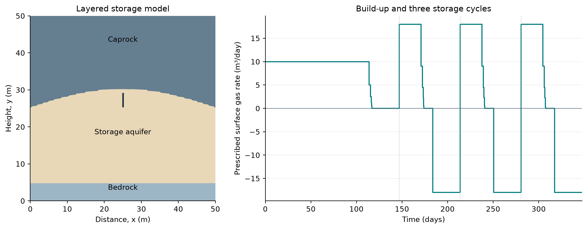
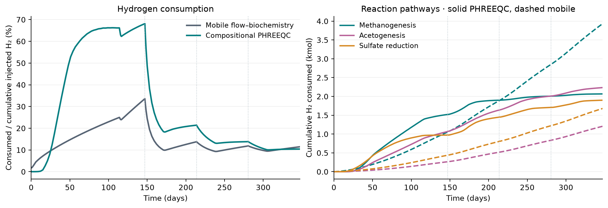
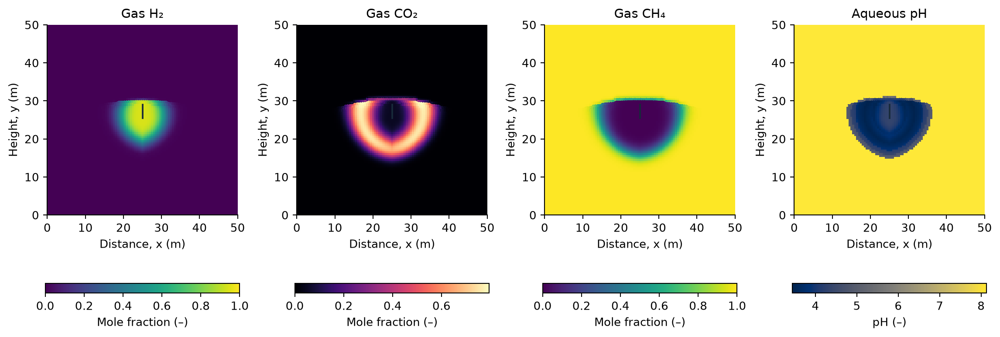

Three-cycle reactive storage in 2D
==================================

Follow hydrogen and microbial populations through build-up, injection,
idle periods, and withdrawal in a layered storage model. The completed
comparison extends to **347.4 days and three storage cycles**, with all
accepted states retained as packed simulations.

   A 50 × 50 m cross-section with 10,116 cells. The well geometry and operating
   controls come from the existing 2D mineral-coupling example. This is an
   illustrative layered model, not a calibrated field forecast.

.. list-table:: Physical setup
   :header-rows: 1

   * - Region or property
     - Value
   * - Storage aquifer
     - Porosity 0.25; permeability 10 mD
   * - Caprock
     - Porosity 0.10; permeability 0.01 mD
   * - Bedrock
     - Porosity 0.10; permeability 0.0001 mD
   * - Temperature
     - 317.50 K
   * - Initial salinity
     - 2.865 mol/kg water NaCl
   * - Microbial pathways
     - Methanogenesis (MET), acetogenesis (ACE), sulfate reduction (SRB)

The paired simulations use compositional thermodynamics and the same grid
and well schedule. The baseline solves mobile microbial populations with
flow; the coupled case uses cell-local geochemical kinetics and mineral
chemistry. Neither enables molecular diffusion, mechanical dispersion,
bacterial diffusion, chemotaxis, or bioclogging. The workflow comparison
therefore includes changes in kinetic formulation and population transport;
it does not isolate mineral chemistry alone.

Explore hydrogen and microbial evolution
-----------------------------------------

Choose a workflow, press **Play**, or move the time slider. Colors retain the
same logarithmic limits through time and between workflows. The animation
uses selected accepted states, with no interpolated spatial fields.

.. raw:: html

   <iframe id="h2sim-field-explorer" src="_static/field2d/explorer.html" title="Interactive animation of dissolved hydrogen and three microbial populations over three cycles" loading="lazy" style="width:100%;height:1130px;border:0;border-radius:14px;"></iframe>
   

The hydrogen panel shows **liquid-phase H₂ mole fraction**, not gas saturation.
Population panels show the model population scale relative to its initial
value. They make fronts and localized activity visible, but the two kinetic
formulations use different biomass representations. Equal colors do not
establish equal physical biomass.

In the PHREEQC workflow, populations remain **cell-local**: spatial changes
represent growth and decay. Select the mobile workflow to see aqueous
transport together with growth and decay. Neither animation depicts
chemotaxis or follows individual bacteria.

.. _phreeqc-2d-loss:

Hydrogen consumption and reaction pathways
------------------------------------------

   Left: cumulative microbial consumption divided by cumulative prescribed
   hydrogen injection at each plotted time. Right: MET, ACE and SRB
   contributions; solid curves use PHREEQC, dashed curves use mobile kinetics.
   Dotted lines mark the starts of the three storage cycles.

The final consumed amounts are **6.199 kmol (10.426%)** with compositional
PHREEQC and **6.818 kmol (11.466%)** with mobile flow–biochemistry. These
percentages measure metabolic conversion, excluding dissolved or unrecovered
hydrogen. Unlike the 1D validation page, the denominator here grows with
cumulative prescribed injection; it is not the final total injection used
at every time.

Gas composition and aqueous chemistry
--------------------------------------

   Compositional PHREEQC at the end of the third injection period
   (day 307.6). Gas compositions are hidden where gas saturation is below
   10⁻⁶; pH is shown throughout the aqueous domain. No pressure map is needed
   to inspect the hydrogen plume and its chemical environment.

This selected mineral inventory represents Bentheimer sandstone: 2% dolomite
and 98% inert rock by mass, with no initial calcite.

The chemical maps complement the bulk consumption curves: hydrogen exposure,
carbon conversion, and pH evolve unevenly around the well. The available
per-cell element-audit diagnostics are retained in the result provenance.
The coupled result records 62 cell-update audit failures across the three
segments, with a maximum absolute residual of 2.68 × 10⁻⁶ mol. The baseline
has no equivalent geochemical audit. These counts cover accepted-state
diagnostics, not rejected chemistry attempts. The figures do not establish
elemental conservation or grid convergence.

Use the existing example
------------------------

.. code-block:: matlab

   startupH2sim
   exampleCompositionalBacterial2DPhreeqcMinerals

This is the public entry point for the layered mineral-coupling setup.
The displayed three-cycle results are saved continuations of that setup;
they are not a claim that the default call reproduces the entire comparison.
Save the setup and accepted states with the packed-simulation utilities to
retain spatial fields and redraw figures without rerunning chemistry.

.. seealso::

   :doc:`phreeqc` describes kinetic ownership and the supported coupling
   workflows. :doc:`notebooks/bacterial_storage_2d` covers mobile microbial
   transport in the separate depleted-reservoir example.

.. only:: html

   Download the :download:`consumption histories <_static/field2d/histories.csv>`
   and :download:`result provenance <_static/field2d/provenance.json>`.
