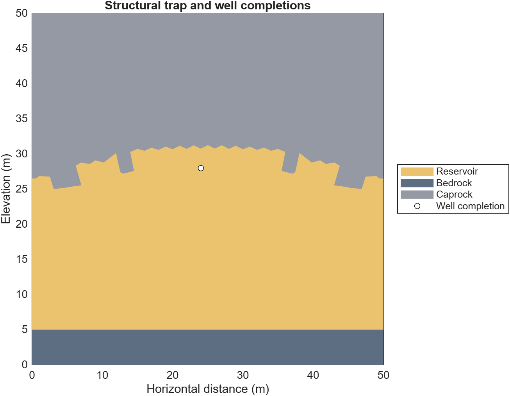
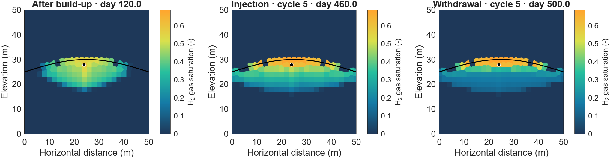
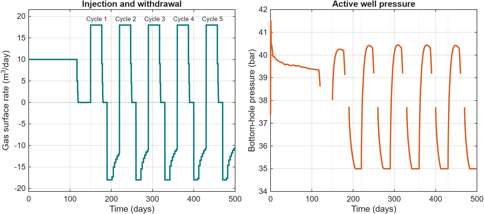
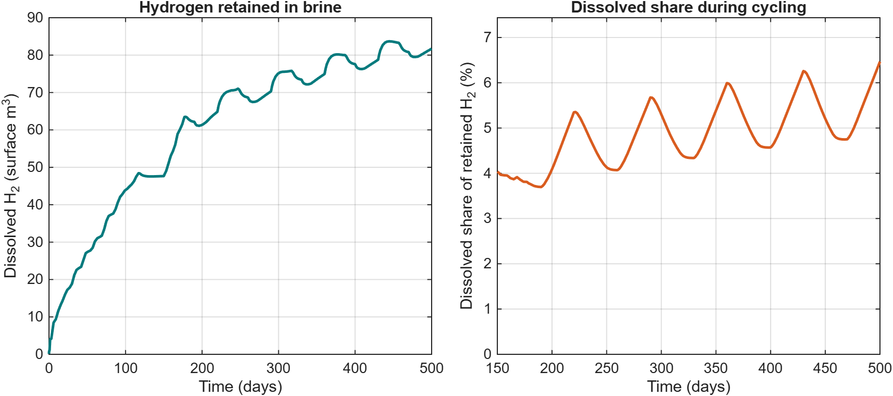
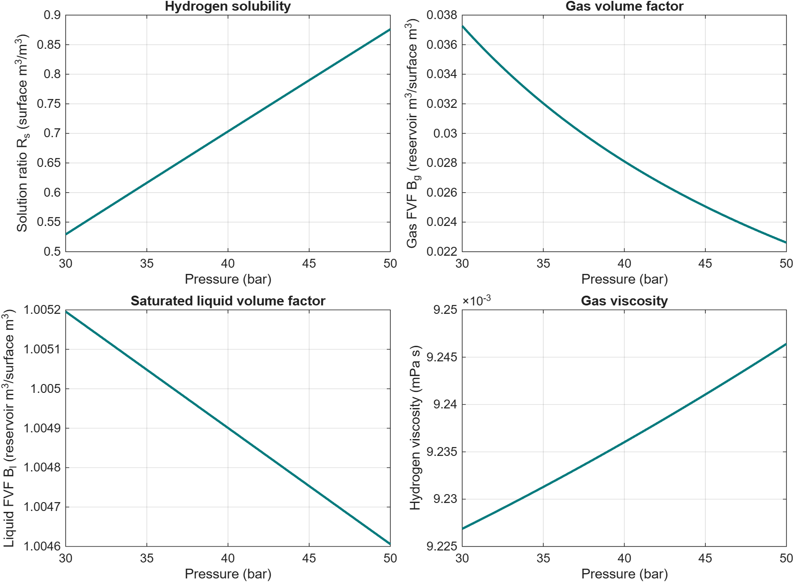

Hydrogen storage in saline aquifers
===================================

Black-oil models · ``h2-store``

The storage module connects hydrogen–brine fluid properties to MRST black-oil
models. It provides PVT tabulation, relative-permeability tools, and aquifer
setups for injection, storage, and withdrawal.

A 2D structural-trap example
----------------------------

.. code-block:: matlab

   result = exampleBlackOilAquifer2D('numCycles', 5);

This example uses the existing 50 m × 50 m illustrative aquifer setup.
A curved low-permeability caprock overlies the reservoir, with bedrock below.
A single well sits beneath the crest. Gravity, capillary pressure, and
hydrogen dissolution are included; lateral boundaries use hydrostatic
pressure. The bundled input uses zero added salt and disables diffusion.

The default teaching grid has a 2 m target spacing. The original setup's
0.5 m target spacing remains available. The schedule includes a 120-day
hydrogen build-up, a 30-day shut-in, then five 70-day storage cycles
(30 days of injection, 10 days idle, and 30 days withdrawal). Results are
saved through MRST packed simulation output and can be replotted locally.
Withdrawal has a 35 bar minimum bottom-hole pressure limit, so the well can
reduce its rate as available hydrogen decreases.

.. raw:: html

   <video controls loop muted playsinline preload="metadata" style="width:100%;max-width:1280px" poster="_static/examples/aquifer_storage.png" aria-label="Simulated hydrogen injection, shut-in and withdrawal in a saline aquifer">
     <source src="_static/examples/aquifer_storage.mp4" type="video/mp4">
     <a href="_static/examples/aquifer_storage.gif">View the animated GIF</a>.
   </video>

The animation follows the same presentation as :doc:`hydrogen-anticline`:
fixed saturation limits, labelled operating stages, and a history of retained
hydrogen. The orange inventory curve shows dissolved hydrogen, which remains
inside the model. The rate panel uses positive injection and negative withdrawal.
Initial and accepted states are selected by physical time, retaining every
operating-stage endpoint, without interpolation. Labelled simulation times are
uneven; playback is not real time. The 2D section has no vertical exaggeration.
The saturation range is fixed across this case's frames and snapshots; its
upper limit comes from this simulation, rather than the anticline case.

Download the :download:`MP4 <_static/examples/aquifer_storage.mp4>`,
:download:`GIF <_static/examples/aquifer_storage.gif>` or
:download:`provenance record <_static/examples/aquifer_gallery_provenance.json>`.

Geological structure
~~~~~~~~~~~~~~~~~~~~

   The three rock regions and the actual completion cells in the teaching grid.
   Elevation increases upward; distances are in metres.

:download:`Download vector PDF <_static/examples/aquifer_geology.pdf>`.

Plume development
~~~~~~~~~~~~~~~~~

   Saved-state snapshots use the animation's saturation palette and fixed
   limits. Labels show actual simulation times.

:download:`Download vector PDF <_static/examples/aquifer_plume.pdf>`.

Operating response
~~~~~~~~~~~~~~~~~~

   Well response through the prescribed storage schedule. Positive gas rate
   denotes injection and negative gas rate denotes withdrawal. Rates are
   constant over each completed schedule interval; inactive-well BHP is omitted.

:download:`Download vector PDF <_static/examples/aquifer_well_response.pdf>`.

Hydrogen loss due to dissolution
~~~~~~~~~~~~~~~~~~~~~~~~~~~~~~~~

Dissolution transfers hydrogen from the free-gas plume into brine. We report
its surface-equivalent volume and its fraction of the hydrogen inventory
remaining inside the modeled reservoir:

.. math::

   V_{\mathrm{diss}} = \sum_c PV_c S_{l,c} b_{l,c} R_{s,c}, \qquad
   L_{\mathrm{diss}} = 100\,\frac{V_{\mathrm{diss}}}
   {V_{\mathrm{diss}} + \sum_c PV_c S_{g,c} b_{g,c}}.

Here, :math:`c` indexes cells, :math:`PV` is pore volume, :math:`S` is phase
saturation, :math:`b=1/B` is the inverse formation-volume factor, and
:math:`R_s` is the dissolved gas solution ratio. Both volumes use the same
surface conditions. This metric describes loss from the free-gas inventory;
it is not cumulative loss relative to injected hydrogen or irreversible
consumption. Hydrogen can exsolve during pressure decline, and the fraction
can increase during withdrawal as the free-gas inventory decreases.

   Hydrogen partitioned into brine throughout build-up and cycling (left),
   with the dissolved share shown over the cycling period (right).

:download:`Download vector PDF <_static/examples/aquifer_dissolution.pdf>` or
:download:`inventory data (CSV) <_static/examples/aquifer_dissolution.csv>`.

Reproduce the animation and figures from the same result:

.. code-block:: matlab

   startupH2sim
   result = exampleBlackOilAquifer2D('numCycles', 5, 'plotResults', false);
   output = fullfile('build', 'aquifer-gallery');
   animateBlackOilAquifer2D(result, output, 'frameRate', 6, 'maxFrames', 100);
   plotBlackOilAquifer2D(result, 'outputDirectory', output);
   plotAquiferFluidTables(result, 'outputDirectory', output);

Set ``'writeVideo', false`` when the MPEG-4 VideoWriter profile is unavailable.
The GIF and poster remain available. Plotting and animation functions only read
saved results; they do not rerun flow or alter the physical model.

.. button-ref:: notebooks/blackoil_storage
   :color: primary

   Open the 2D aquifer notebook →

Black-oil interpretation
------------------------

The MRST oil phase represents liquid water/brine and the gas phase represents
hydrogen. ``DISGAS`` enables hydrogen dissolved in the liquid; ``VAPOIL``
enables vaporized water when supported by the supplied PVT tables. The
selected aquifer deck enables dissolution and does not enable vaporization.

The example uses the public illustrative-case input tables accompanying
Ahmed et al., *Phase behavior and black-oil simulations of hydrogen storage
in saline aquifers* (2024). Input provenance is recorded in
``h2-store/examples/data/Aquifer2D/README.md``.

Build fluid tables
------------------

``examplePVTGenerationH2Brine`` demonstrates pure-component properties,
solubility, and PVT generation. New NIST data tables require network access.
See :doc:`thermodynamics` for RK, SW, Henry–Setschenow, ePC-SAFT reference
comparisons, and the route from phase behavior to black-oil tables.

   PVT functions from the bundled aquifer input, evaluated over 30–50 bar.
   These are the existing simulation tables, not newly generated NIST data.

:download:`Download vector PDF <_static/examples/aquifer_fluid_tables.pdf>` or
:download:`fluid data (CSV) <_static/examples/aquifer_fluid_tables.csv>`.

Replot the fluid properties from a saved aquifer result:

.. code-block:: matlab

   plotAquiferFluidTables(result);

For contributors, the :download:`Model presentation guide <model-presentation.md>`
records the figure and animation conventions used on this page.
